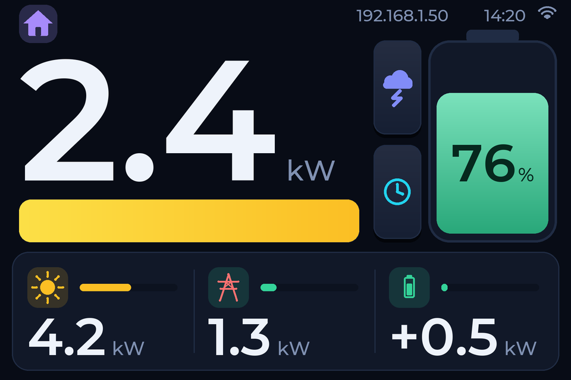
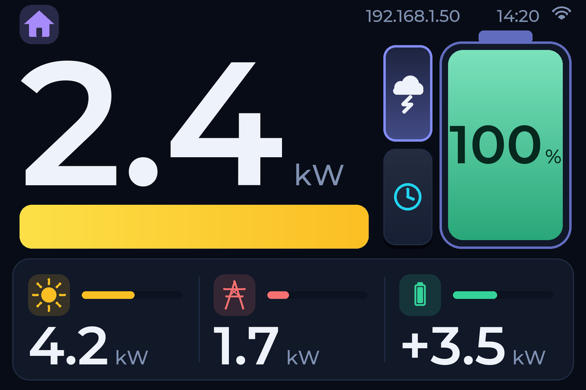
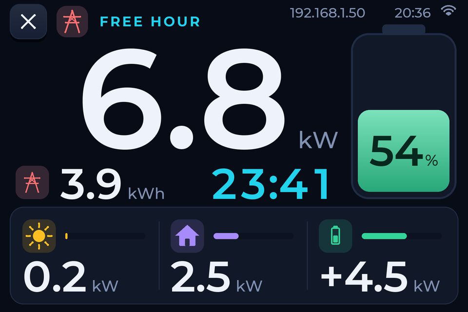
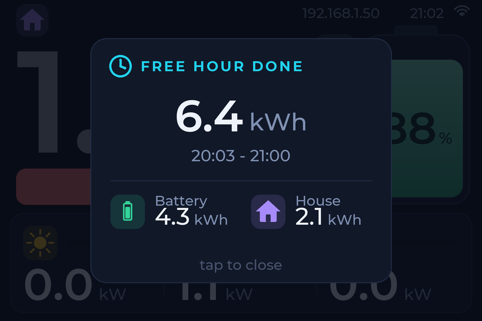
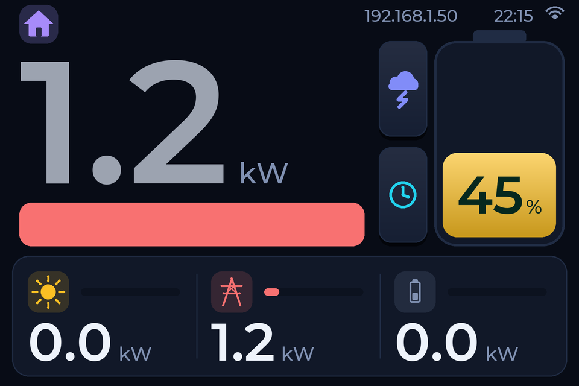

# esp32-sigen-monitor

**Sigenergy** home solar system dashboard for ESP32 touchscreen. In addtion to displaying data, it lets you control the solar system.

It is self contained and does not require the cloud, an app, or Home Assistant.


## What it shows



*The home screen: house load, source mix, battery charge and the solar, grid and battery flows.*

- **House load**: the big number at top.
- **Source mix bar**: how much of that load comes from solar, the battery and the grid.
- **Battery** state of charge.
- **Solar, grid and battery flows**: shows import/export and charge/discharge.
- **Clock** and the system's IP address 

## Features


- **Charge button.** Press this to sets the system's Backup SOC to 100%, for example to charge the battery when a big weather event is forecast. 

  

  *When the button is pressed the battery reserve is held at 100%.*

- **Free hour mode.** For power companies that offer you a free hour electricity. Tap the clock button to make the house run entirely from the grid and charge the battery at full power. It automatically switches off at the top of the hour. The big number on screen switches to shows the grid import.

  

  *Free hour: the big number shows grid import, with the kWh used so far and a countdown to the top of the hour.*

  When the free hour ends, it will show a summary of total energy used from the grid, start and end times, and how much of that went into the battery and the house.

  

- **Off-peak indicator.** Between 21:00 and 07:00, when the overnight rate is cheaper, the big number turns grey.

  

  *Off-peak: after 21:00 the big number is grey.*


- **Auto-brightness.** The screen adjusts brightness according to room light level, and will switch off when the room is completely dark.

## Hardware

| Part | Notes |
|---|---|
| **Sunton ESP32-3248S035R** (aka "Cheap Yellow Display") | 3.5" 480×320 ST7796 LCD, resistive XPT2046 touch, ESP32-WROOM-32, CH340 USB-serial. It should be relatively simple to port it to other ESP32 with a touchscreen. |
| USB cable and charger | To power it from the wall. |

You need to enable the **Modbus TCP server** on the Sigenergy and the ESP32 must be on the same LAN. If Modbus TCP isn't on, ask your installer to enable it.

## Building and flashing

The firmware is a [PlatformIO](https://platformio.org/) project for the Arduino framework, using [LVGL](https://lvgl.io/) 9 and [esp32_smartdisplay](https://github.com/rzeldent/esp32-smartdisplay).

1. Install PlatformIO, either the VS Code extension or the CLI.
2. Copy the secrets template and fill in your WiFi network name and password:

   ```sh
   cp include/secrets.h.example include/secrets.h
   ```

   `secrets.h` is gitignored, so your WiFi details stay out of the repo.

3. Optionally, change any other settings in [include/settings.h](include/settings.h). See [Configuration](#configuration).
4. Build:

   ```sh
   pio run
   ```

5. Flash. The board's CH340 auto-reset doesn't reliably enter download mode by itself, so **hold BOOT, tap RESET, then release BOOT** before uploading:

   ```sh
   pio run -t upload --without-building
   ```

   If you see `Wrong boot mode detected (0x13)`, the board wasn't in download mode. Do the BOOT/RESET step again and retry.


On first boot it scans the /24 subnet for a Modbus TCP device on port 502 and checks each one with a test read. The answer has to look like a Sigenergy system: a non-zero rated power (register 30010) and a battery SOC (30014) between 0 and 100%. It then saves the IP for future boot.


## Touch calibration

These boards' resistive touch panels vary from unit to unit. To calibrate:

1. Hold the clock (top right) for 5 seconds.
2. Press and hold the centre of each of the three crosses in turn.
3. A fourth cross checks the result. If your tap lands within 12 px of it, the calibration is saved to flash and loaded on every boot.

## Configuration

All settings are in [include/settings.h](include/settings.h). The only exceptions are the WiFi network name and password, which go in `include/secrets.h`.

| Setting | Default | What it does |
|---|---|---|
| `TZ_INFO` | New Zealand | POSIX timezone string for the clock, e.g. `"AEST-10AEDT,M10.1.0,M4.1.0/3"` for Sydney |
| `OFFPEAK_START_HOUR`, `OFFPEAK_END_HOUR` | 21, 7 | When the big number is shaded grey for the off-peak rate |
| `CHARGE_ON_SOC`, `CHARGE_OFF_SOC` | 100, 30 | Backup reserve (%) the Charge button sets when pressed in and when released |
| `CHARGE_SYNC_INTERVAL_MS` | 60000 | How often the Charge button rereads the reserve from the system |
| `FREE_HOUR_CHARGE_PCT` | 100 | How hard the battery charges from the grid during a free hour, as % of the inverter's rated power |
| `BAR_MAX_KW` | 8.0 | Full-scale value for the solar/grid/battery bars |
| `CDS_BRIGHT_RAW`, `CDS_DARK_RAW` | 30, 400 | Light-sensor thresholds for auto-brightness.  |
| `BL_MIN`, `BL_MAX` | 0.08, 1.0 | Dimmest and brightest backlight levels |
| `CDS_OFF_RAW`, `CDS_ON_RAW` | 800, 600 | Light-sensor readings at which the screen switches off in a dark room, and back on |
| `SCREEN_OFF_IDLE_MS` | 30000 | How long the screen has to go untouched before it can switch off |
| `CAL_HOLD_MS` | 5000 | How long to hold the clock to start touch calibration |
| `TOUCH_CAL_FALLBACK` | | Touch calibration used until one has been saved on the device |
| `STATUS_LED` | false | Use the board's RGB LED as a connection and power-flow indicator |

## Serial console

There is a serial console at 115200 baud. Connect as follows:

   ```sh
   pio device monitor
   ```

| Command | Details |
| (auto) | Light reading is shown every 10 seconds |
| `diag` | device connection state and why it last restarted |
| `cal` | Calibrate screen |


## Modbus registers

Everything is read from the system address (slave 247).

The live values come from a single block read of 30005–30038, about once a second:

| Register | Value | Notes |
|---|---|---|
| 30005 | Grid power | s32, W; positive = importing |
| 30014 | Battery SOC | u16, %×10 |
| 30035 | PV power | s32, W |
| 30037 | Battery power | s32, W; positive = charging |

House load is calculated as `PV + grid − battery`.

The Charge button uses one more register, outside that block:

| Register | Value | Notes |
|---|---|---|
| 40046 | Backup SOC (read/write) | u16, %×10. Written when Charge is tapped. Read on connect and every 60 s after that, so the button follows changes made in the mySigen app. |

The system asks for at least one second between requests, so the firmware sends one request at a time. When a Charge write or Backup SOC read is due, it takes the place of that second's poll.

### Free hour

Free hour uses the system's remote EMS control (Appendix 6 of the Sigenergy Modbus Protocol V2.9):

| Register | Value | Notes |
|---|---|---|
| 40029 | Remote EMS enable | u16, 1 = on, 0 = off (the mySigen app's own mode) |
| 40031 | Remote EMS mode | u16, set to 0, "PCS remote control" |
| 40005 | Active power percentage | s16, %×100 of the inverter's rated power; negative = take power from the grid (charge) |

To start, it writes 40029 = 1, then 40031 = 0, then 40005 = −`FREE_HOUR_CHARGE_PCT`×100. To end, it writes 40005 = 0, then 40029 = 0. If the system refuses to turn remote EMS off, the screen shows "STILL GRID CHARGING" and the release is retried every 60 seconds. If the ESP reboots during a free hour, it releases remote EMS as soon as it reconnects. The protocol has no timeout of its own.

The energy figures come from the system's lifetime counters (u64, kWh×100), read as one block (30200–30231) when free hour starts, every 30 seconds while it runs, and once more when it ends. They match the mySigen app's statistics and keep counting if the connection drops.

| Register | Value |
|---|---|
| 30200 | Total energy charged into the battery |
| 30216 | Total energy imported from the grid |
| 30228 | Total house load (from every source) |


## Project layout

```
src/main.cpp               startup and the connection state machine
src/discovery.cpp          finds the system on the network
src/plant.cpp              talks to the system once connected: live readings, Charge, Free hour
src/modbus_tcp.cpp         Modbus TCP client
src/sigenergy.h            Modbus register map
src/dashboard.cpp          the screen: layout, live values, Charge and Free hour modes
src/widgets.cpp            LVGL building blocks and icons
src/theme.h                colours and custom fonts
src/display.cpp            backlight: auto-brightness, screen off in the dark
src/touch_calibration.cpp  on-screen touch calibration
src/status_led.cpp         optional RGB status LED
src/diagnostics.cpp        connection diagnostics on the serial port
src/storage.h              keys for what's saved on the device
src/font_hero_144.c        custom font for the big number (digits only)
src/font_num_44.c          custom font for secondary numbers and the countdown
include/settings.h         settings
include/lv_conf.h          LVGL configuration
include/secrets.h.example  WiFi credentials template
boards/                    board definition for the ESP32-3248S035R
```

## Acknowledgements

The Modbus register map and control logic draw on the work of these projects:

- [TypQxQ/Sigenergy-Local-Modbus](https://github.com/TypQxQ/Sigenergy-Local-Modbus)
- [Rocket-Search/sigenergy-modbus](https://github.com/Rocket-Search/sigenergy-modbus)

Thanks also to [rzeldent/esp32-smartdisplay](https://github.com/rzeldent/esp32-smartdisplay) for the board support package, and to the [LVGL](https://lvgl.io/) project.

## Licence

See [LICENCE.md](LICENCE.md). Contact me for commercial licencing.
